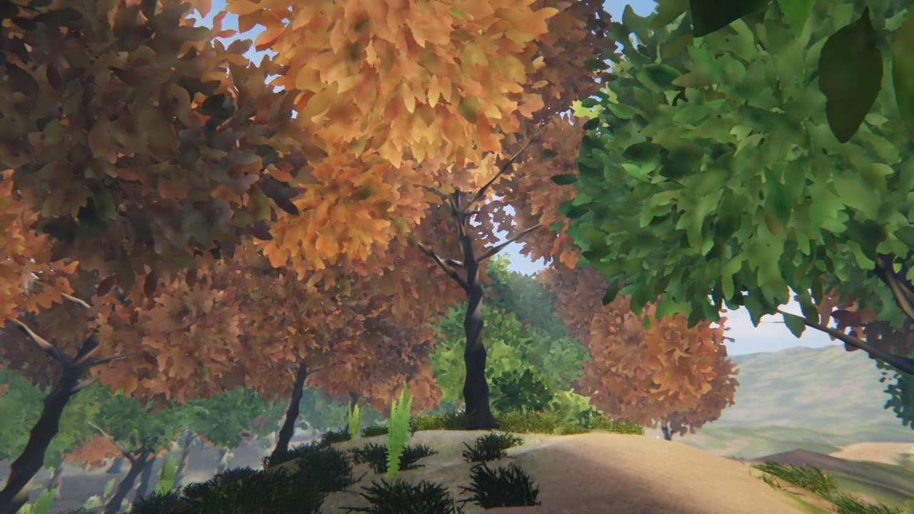
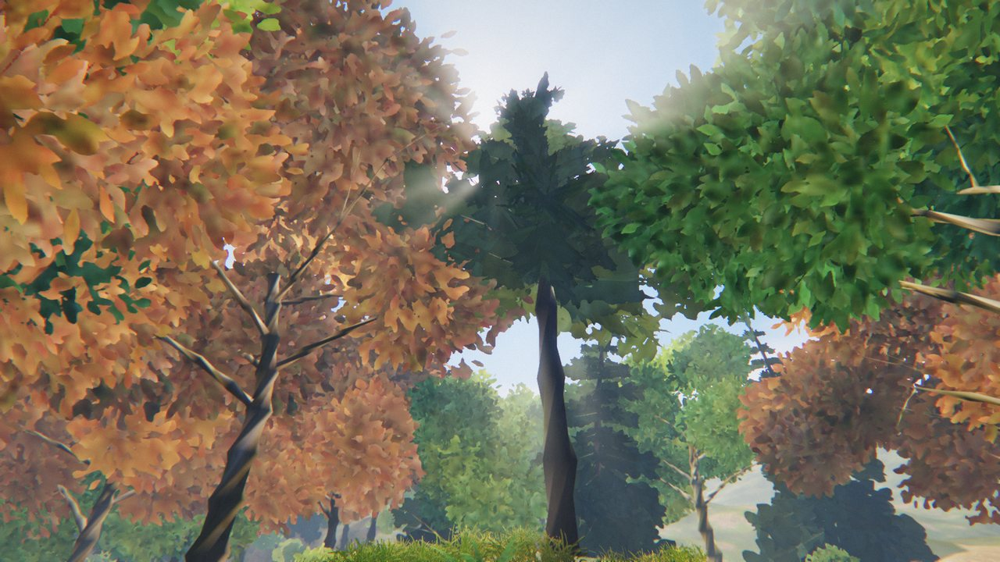
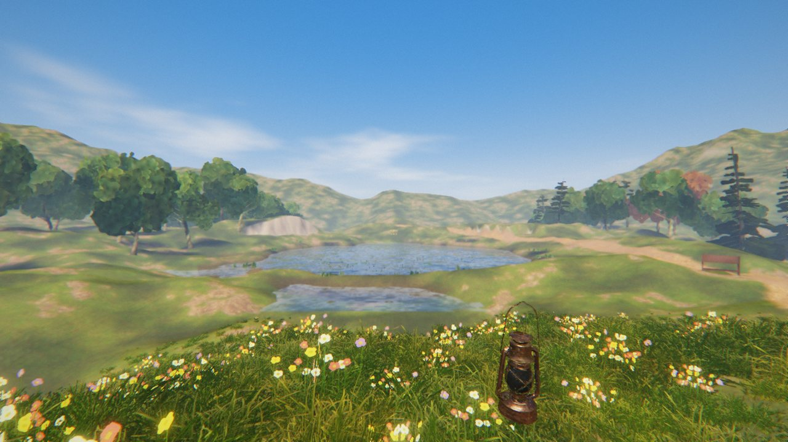
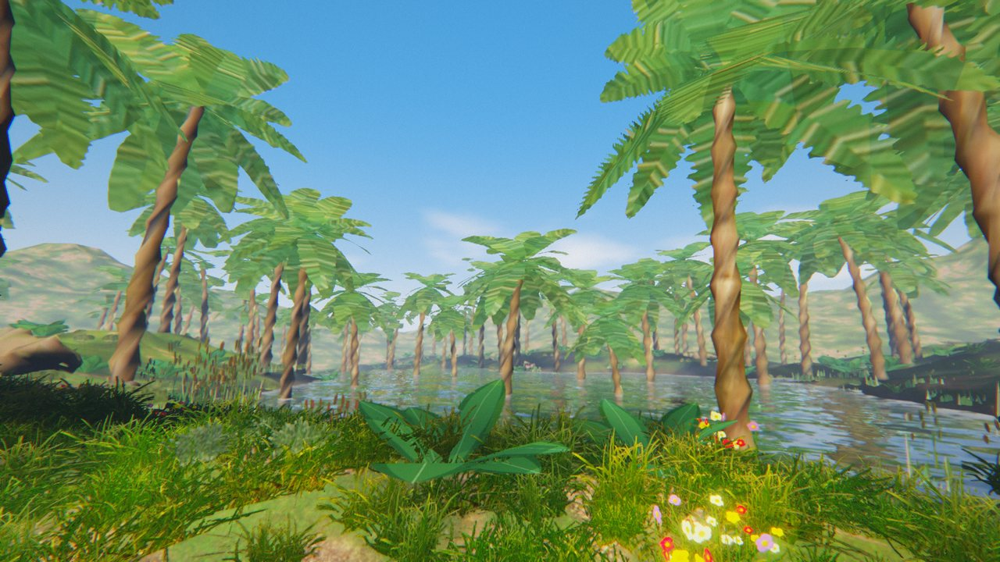
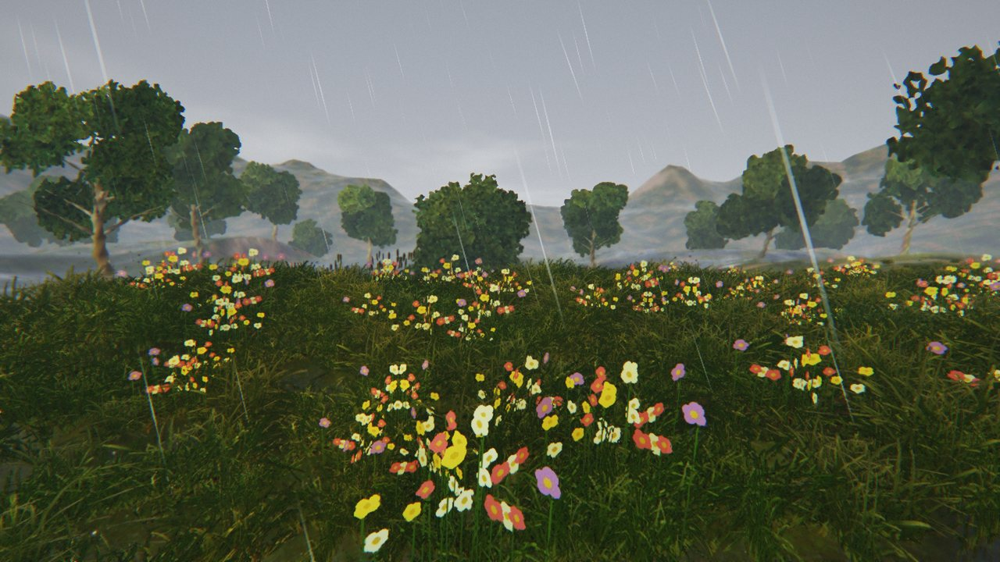
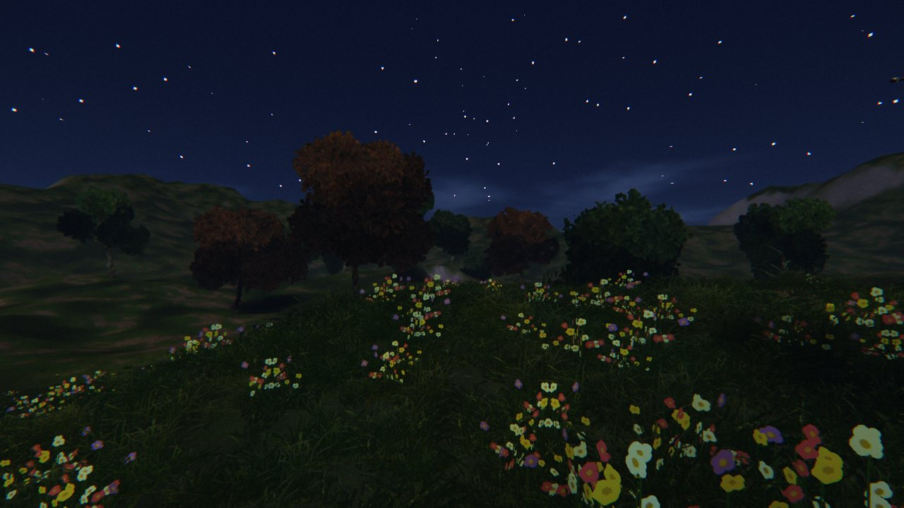
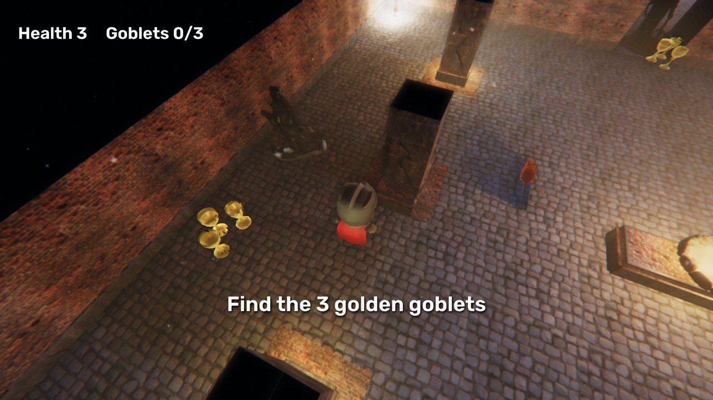

# Loophole Engine

A 3D game engine for Scratch and TurboWarp. You describe a level in a short Python file, run `loophole build`, and get an `.sb3` that opens in TurboWarp. Gameplay is ordinary Scratch blocks reading and setting ordinary variables.




Every image on this page is a real TurboWarp frame captured by the playtest harness in `tools/harness`.

| Meadow with wildflowers | Sunbeams through the canopy | Autumn forest at dusk |
| --- | --- | --- |
|  |  |  |

| Lake with reeds and lily pads | Snowy pass in falling snow | Tropical lagoon |
| --- | --- | --- |
|  |  |  |

| Rain on a meadow | Starry night |
| --- | --- |
|  |  |

| Afterglow valley at dusk | Lab puzzle, first person | Orchard, third person | Crypt, top down |
| --- | --- | --- | --- |
|  |  |  |  |


## What you get

- Lightmaps with baked global illumination, a sun and sky for outdoor levels, flickering torches and switchable lights.
- PBR materials from a CC0 texture library (lab panels, brick, plaster, cobble, grass, rock, gravel, roof tiles and more), plus about 60 props such as trees, lamps, furniture, barrels and statues.
- Terrain with grass that ripples in the wind, wildflower meadows, paths and a horizon. Buildings with roofs, framed windows and doors.
- Lakes and rivers with reflections, ripples, shore foam and swimming. Biomes for meadow, forest, snow, tropical, swamp and dry country, any time of day with stars at night, and rain, snow or fog that Scratch can switch on and off.
- Forests in one line: `level.forest(x0, z0, x1, z1)` plants oaks, maples, birches, willows, pines and spruces with bushes, ferns, logs and mossy rocks, lit with dappled shade and sunbeams, at 60 frames per second.
- First person, third person, top-down and free cameras. Four animated player characters, or import your own rigged glTF.
- Objects that you can pick up and carry, buttons and doors, pickups that spin and glow, enemies that walk paths, triggers and goals.
- On-screen text that you set from Scratch, letters on signs, OBJ and glTF model import.
- Optional portals: `game.portals(True)` adds a portal gun. Portals are see-through (recursively, so facing portals make a tunnel) and walk-through, they keep your momentum, and they carry the cube you're holding.

## Make a game in five minutes

You need Python 3.9 or newer and a browser.

1. Get the engine and install it in a virtual environment.

   ```
   git clone https://github.com/q8j-dev/loophole-engine.git
   python3 -m venv lh-env
   source lh-env/bin/activate        # Windows: lh-env\Scripts\activate
   pip install ./loophole-engine
   ```

2. Create a project and build it.

   ```
   loophole new mygame
   cd mygame
   loophole build
   ```

   The first build bakes the lighting, which takes a few seconds. Later builds reuse the bake until you change the level.

3. Open [turbowarp.org/editor](https://turbowarp.org/editor), choose File > Load from your computer, and pick the `.sb3` that `loophole build` printed. Click the green flag, then click the stage. Move with WASD, look with the mouse, jump with space, and pick things up with E.

4. Change the level. Open `mygame/world.py`. It is a list of instructions; here is a shortened version:

   ```python
   from loophole import Game

   game = Game("Mygame")

   lab = game.level("Lab")
   lab.room(0, 0, 0, 12, 6, 14)
   lab.spawn(6, 0, 12, yaw=0)
   lab.cube("cube", 9, 0, 9)
   lab.button("button", 3, 0, 4, opens="door")
   lab.door("door", 6, 0, -0.6, facing="+z", width=2, height=3)
   ```

   Add a line such as `lab.prop("barrel", 2, 0, 12)` or `lab.sign("EXIT", 6, 3.3, 0)`, run `loophole build` again and reload the file in TurboWarp.

5. Add gameplay in Scratch. The Stage has variables like `player x`, `camera mode`, `message` and `status`, and lists like `obj name` and `light power`. Broadcasts such as `collect`, `touch`, `enter goal` and `level start` tell your scripts what happened. For example, this script keeps score:

   ```
   when I receive [collect]
   change [score] by (1)
   set [status] to (join [Score: ] (score))
   ```

   When you rebuild, Loophole replaces only its own Engine sprite. Your sprites, scripts, variables and sounds stay as they are.

If you prefer typing to dragging blocks, `game.script("game.py")` compiles a Python file into Scratch blocks in a Game sprite. The examples use it.

## Examples

Each example uses only the public API and has a scripted playthrough in `tools/harness/runs`.

- [examples/showcase](examples/showcase): Afterglow. A first-person lab puzzle with a cube, button and door, followed by a dusk valley where you find three lanterns to light the house. The held item switches from the lab device to a lantern.
- [examples/orchard](examples/orchard): Orchard Dash. A third-person race to collect 12 apples before the timer runs out, with rats patrolling the rows. You play the rogue.
- [examples/crypt](examples/crypt): Crypt Crawl. A top-down crypt lit by torches. Collect three goblets to sink the statue that blocks the treasure vault, and keep away from the giant rats. You play the knight.

- [examples/journey](examples/journey): The Long Walk. Walk from autumn woods past a lake you can swim across to a snowy pass and a warm cabin.
- [examples/woods](examples/woods): Autumn Woods. A forest to walk through, made with two `forest()` calls.
- [examples/portals](examples/portals): Portal Lab. Carry a cube up to a ledge through a portal, fall into a floor portal to be flung across a slime pit, and put the cube on the button that opens the exit.

Build one with `loophole build examples/orchard`.

## Documentation

- [docs/world-api.md](docs/world-api.md): every `Game` and `Level` method for building levels.
- [docs/scratch-api.md](docs/scratch-api.md): every variable, list and broadcast your Scratch scripts can use.
- [docs/renderer.md](docs/renderer.md): how the renderer works, from the bake to the final frame.
- [ROADMAP.md](ROADMAP.md): what is finished and what is not.

## Requirements

The build runs on macOS, Linux and Windows with Python and two packages, numpy and Pillow. Games run in TurboWarp (the website or the desktop app) and use the Pen+ and Pointerlock extensions from the TurboWarp extension gallery, which load automatically. Blender is only needed to rebuild the bundled props, and ffmpeg is never needed.

## License

MIT for the code. The bundled textures, props, characters and fonts are CC0 or SIL Open Font License. [CREDITS.md](CREDITS.md) lists every source.
