# Loophole Engine

A 3D game engine for Scratch and TurboWarp. You describe a level in a short Python file and Loophole builds it into an `.sb3` that opens in TurboWarp. Gameplay is ordinary Scratch blocks reading and setting ordinary variables.

## Start here

**Play an example.** No install. Open one in TurboWarp straight from the table, or download the `.sb3` from the [latest release](https://github.com/q8j-dev/loophole-engine/releases/latest) and load it in [TurboWarp](https://turbowarp.org/editor) with File > Load from your computer. Click the green flag, then click the stage.

| Game | What it is | Play | Download |
| --- | --- | --- | --- |
| Starter lab | The template `loophole new` makes: a small lab with a cube, a button and a door | [Play in TurboWarp](https://turbowarp.org/?project_url=https://q8j-dev.github.io/loophole-engine/games/Starter.sb3) | [Starter.sb3](https://github.com/q8j-dev/loophole-engine/releases/latest/download/Starter.sb3) (6 MB) |
| Afterglow | Lab puzzle, then a dusk valley where you light three lanterns | [Play in TurboWarp](https://turbowarp.org/?project_url=https://q8j-dev.github.io/loophole-engine/games/Afterglow.sb3) | [Afterglow.sb3](https://github.com/q8j-dev/loophole-engine/releases/latest/download/Afterglow.sb3) (29 MB) |
| Orchard Dash | Third-person race for 12 apples past patrolling rats | [Play in TurboWarp](https://turbowarp.org/?project_url=https://q8j-dev.github.io/loophole-engine/games/Orchard-Dash.sb3) | [Orchard-Dash.sb3](https://github.com/q8j-dev/loophole-engine/releases/latest/download/Orchard-Dash.sb3) (13 MB) |
| Crypt Crawl | Top-down torchlit crypt with goblets and giant rats | [Play in TurboWarp](https://turbowarp.org/?project_url=https://q8j-dev.github.io/loophole-engine/games/Crypt-Crawl.sb3) | [Crypt-Crawl.sb3](https://github.com/q8j-dev/loophole-engine/releases/latest/download/Crypt-Crawl.sb3) (7 MB) |
| Portal Lab | Portal puzzles with a cube, a ledge and a slime pit | [Play in TurboWarp](https://turbowarp.org/?project_url=https://q8j-dev.github.io/loophole-engine/games/Portal-Lab.sb3) | [Portal-Lab.sb3](https://github.com/q8j-dev/loophole-engine/releases/latest/download/Portal-Lab.sb3) (10 MB) |
| Autumn Woods | A forest to walk through, made with two `forest()` calls | [Play in TurboWarp](https://turbowarp.org/?project_url=https://q8j-dev.github.io/loophole-engine/games/Autumn-Woods.sb3) | [Autumn-Woods.sb3](https://github.com/q8j-dev/loophole-engine/releases/latest/download/Autumn-Woods.sb3) (18 MB) |
| The Long Walk | Autumn woods, a lake to swim across, a snowy pass and a warm cabin | [Play in TurboWarp](https://turbowarp.org/?project_url=https://q8j-dev.github.io/loophole-engine/games/The-Long-Walk.sb3) | [The-Long-Walk.sb3](https://github.com/q8j-dev/loophole-engine/releases/latest/download/The-Long-Walk.sb3) (31 MB) |

**Make a game in your browser.** [Loophole Studio](https://q8j-dev.github.io/loophole-engine/) runs the real build in the page. Pick a template and change the level in 3D or in code: the Level tab shows the level, lets you place props, lights, collectibles, zones, water, forests and sounds from the toolbar, and move, turn or resize anything with the handles. Every change is written into `world.py` as a normal line of code, and typing in `world.py` updates the 3D view. Press Build game and it plays beside the code. Download the `.sb3` to add Scratch blocks in TurboWarp. The first build downloads about 40 MB; later builds start in a few seconds.

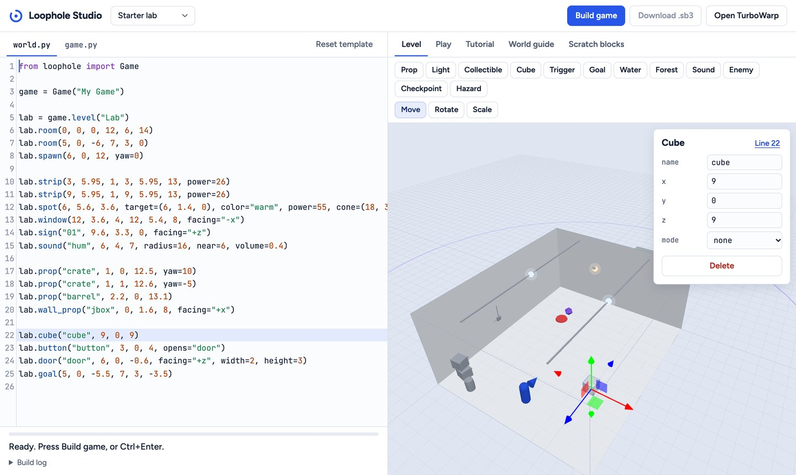

**Install the command line tool** to build from your own folders and keep projects in git. See [Make a game in five minutes](#make-a-game-in-five-minutes) below.


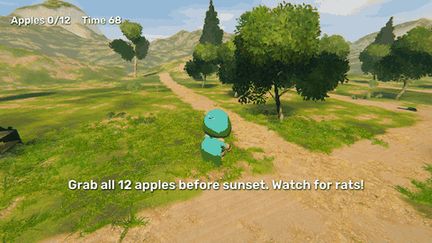

## Gallery

Every image on this page is a real TurboWarp frame captured by the playtest harness in `tools/harness`.

| Meadow with wildflowers | Sunbeams through the canopy | Autumn forest at dusk |
| --- | --- | --- |
| 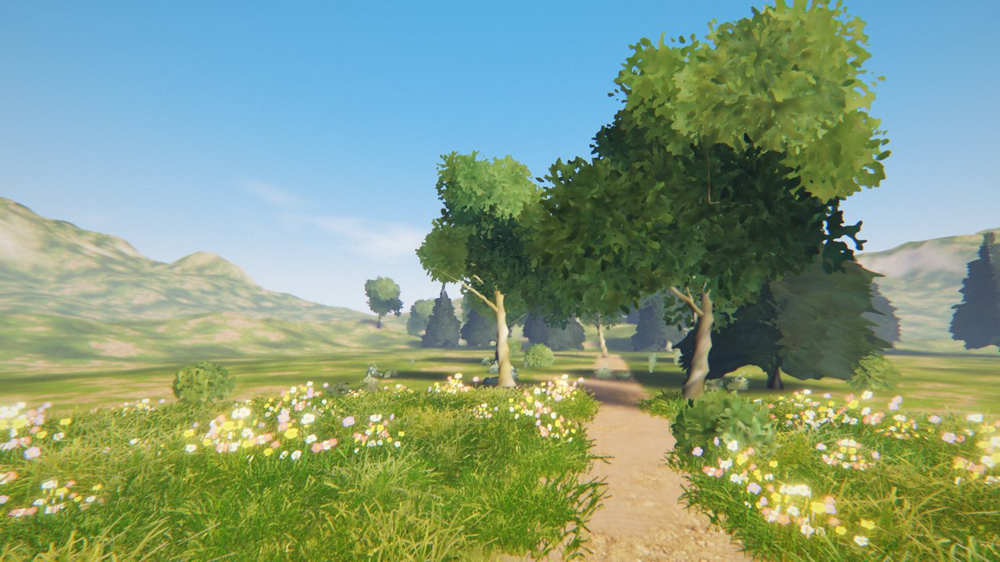 |  | 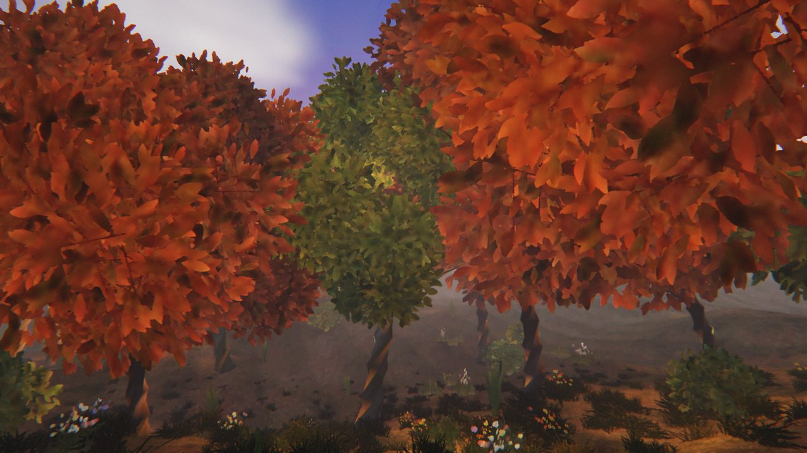 |

| Lake with reeds and lily pads | Snowy pass in falling snow | Tropical lagoon |
| --- | --- | --- |
|  | 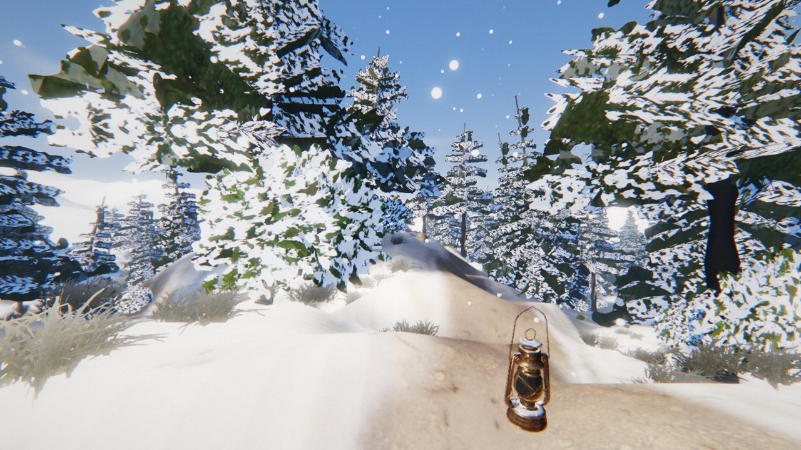 |  |

| Rain on a meadow | Starry night |
| --- | --- |
|  |  |

| Touch controls on a tablet | Crypt Crawl's intro cutscene |
| --- | --- |
| 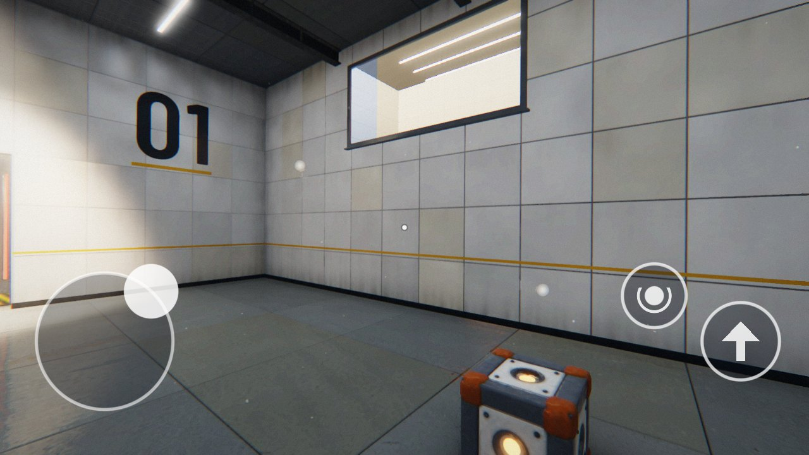 | 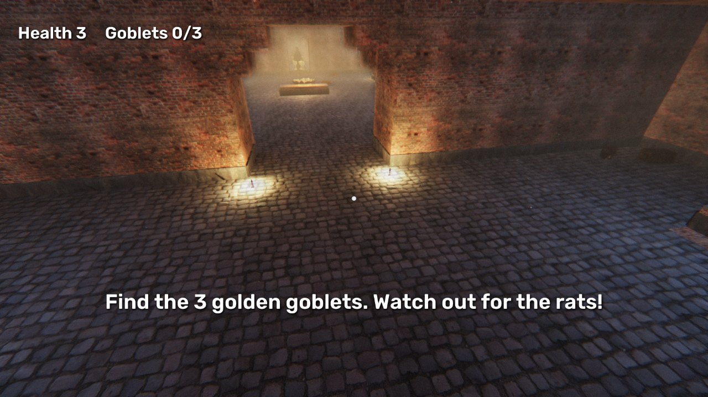 |

| Afterglow valley at dusk | Lab puzzle, first person | Orchard, third person | Crypt, top down |
| --- | --- | --- | --- |
| 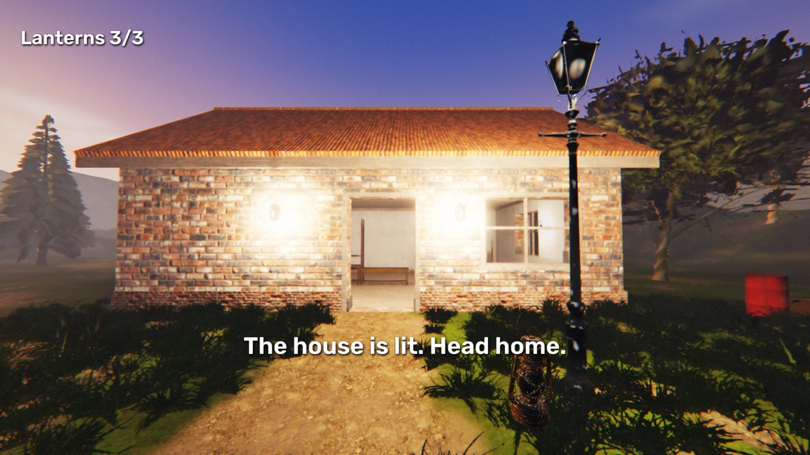 | 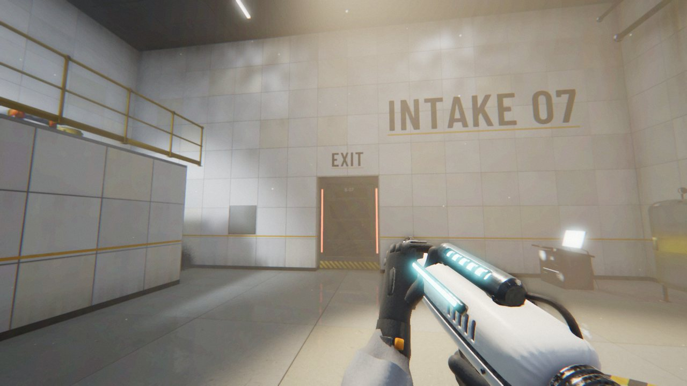 | 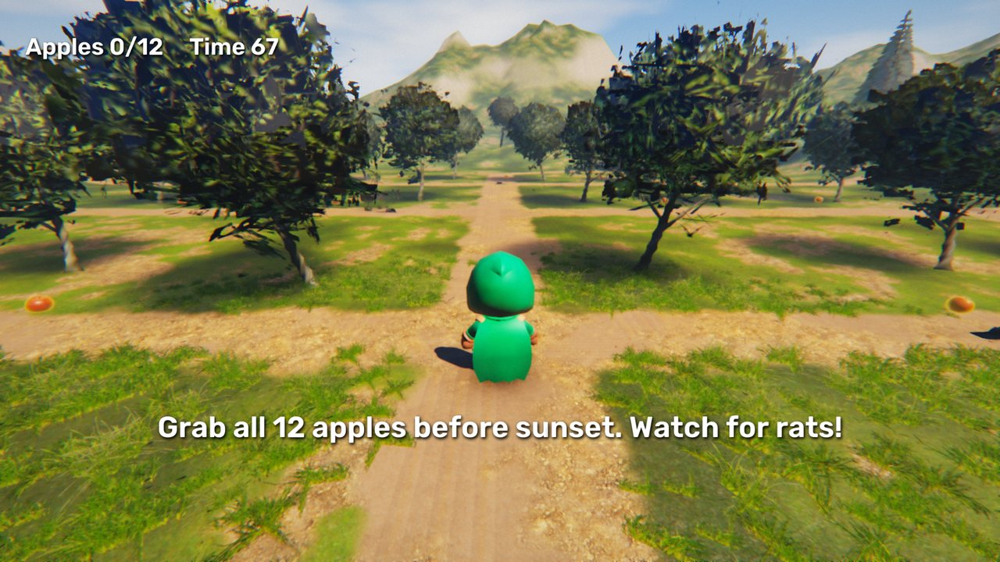 |  |

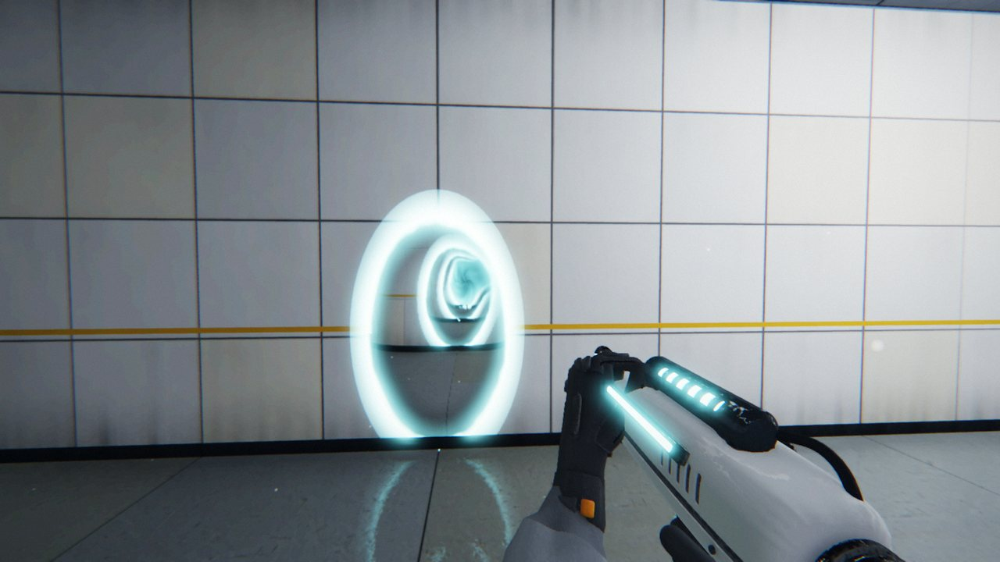

## What you get

- Lightmaps with baked global illumination, a sun and sky for outdoor levels, flickering torches and switchable lights.
- PBR materials from a CC0 texture library (lab panels, brick, plaster, cobble, grass, rock, gravel, roof tiles and more), plus about 60 props such as trees, lamps, furniture, barrels and statues.
- Terrain with grass that ripples in the wind, wildflower meadows, paths and a horizon. Buildings with roofs, framed windows and doors.
- Lakes and rivers with reflections, ripples, shore foam and swimming. Biomes for meadow, forest, snow, tropical, swamp and dry country, any time of day with stars at night, and rain, snow or fog that Scratch can switch on and off.
- Forests in one line: `level.forest(x0, z0, x1, z1)` plants oaks, maples, birches, willows, pines and spruces with bushes, ferns, logs and mossy rocks, lit with dappled shade and sunbeams, at 60 frames per second.
- First person, third person, top-down and free cameras. Four animated player characters, or import your own rigged glTF.
- Objects that you can pick up and carry, buttons and doors, pickups that spin and glow, triggers and goals.
- Physics: boxes stack and slide when you walk into them, objects have mass, friction and bounce, pressure plates need enough weight, doors swing on hinges and lamps sway on ropes.
- Characters that think: they find their way around walls to follow you, wander, patrol or run away, and send `sees player` when they spot you. In Crypt Crawl the rats give chase.
- Plays on tablets, touch Chromebooks and game controllers as well as keyboard and mouse: a joystick and buttons appear when you touch the screen, controllers rumble, and every control can be rebound.
- Checkpoints, save slots that stay in the browser, and save codes made of digits that fit in a cloud variable.
- Cutscenes written in `world.py`: camera paths, subtitles, fades and moving objects, skippable with jump.
- On-screen text that you set from Scratch, letters on signs, OBJ and glTF model import.
- 3D sound: birds in forests, water lapping at lakes, wind outdoors and crackling fires come for free, and `level.sound(...)` places your own. Sounds get louder as you walk closer and pan between your speakers as you turn.
- Optional portals: `game.portals(True)` adds a portal gun. Portals are see-through (recursively, so facing portals make a tunnel) and walk-through, they keep your momentum, and they carry the cube you're holding.

## Make a game in five minutes

You need Python 3.9 or newer and a browser.

1. Get the engine and install it in a virtual environment.

   ```
   git clone https://github.com/q8j-dev/loophole-engine.git
   python3 -m venv lh-env
   source lh-env/bin/activate        # Windows: lh-env\Scripts\activate
   pip install ./loophole-engine
   ```

2. Create a project and build it.

   ```
   loophole new mygame
   cd mygame
   loophole build
   ```

   The first build bakes the lighting, which takes a few seconds. Later builds reuse the bake until you change the level.

3. Open [turbowarp.org/editor](https://turbowarp.org/editor), choose File > Load from your computer, and pick the `.sb3` that `loophole build` printed. Click the green flag, then click the stage. Move with WASD, look with the mouse, jump with space, and pick things up with E.

4. Change the level. Open `mygame/world.py`. It is a list of instructions; here is a shortened version:

   ```python
   from loophole import Game

   game = Game("Mygame")

   lab = game.level("Lab")
   lab.room(0, 0, 0, 12, 6, 14)
   lab.spawn(6, 0, 12, yaw=0)
   lab.cube("cube", 9, 0, 9)
   lab.button("button", 3, 0, 4, opens="door")
   lab.door("door", 6, 0, -0.6, facing="+z", width=2, height=3)
   ```

   Add a line such as `lab.prop("barrel", 2, 0, 12)` or `lab.sign("EXIT", 6, 3.3, 0)`, run `loophole build` again and reload the file in TurboWarp.

5. Add gameplay in Scratch. The Stage has variables like `player x`, `camera mode`, `message` and `status`, and lists like `obj name` and `light power`. Broadcasts such as `collect`, `touch`, `enter goal` and `level start` tell your scripts what happened. For example, this script keeps score:

   ```
   when I receive [collect]
   change [score] by (1)
   set [status] to (join [Score: ] (score))
   ```

   When you rebuild, Loophole replaces only its own Engine sprite. Your sprites, scripts, variables and sounds stay as they are.

   A new project also has a Helpers sprite with ready-made blocks such as `move object [name] to x () y () z ()`, `play sound [name]`, `show message [text]` and `fly camera to ...`, plus example scripts to remix: a button that opens a door, counting collectibles, an enemy that paces, and a camera fly-through on the C key. The [Scratch API](docs/scratch-api.md#helpers-sprite) lists every block.

   

If you prefer typing to dragging blocks, `game.script("game.py")` compiles a Python file into Scratch blocks in a Game sprite. The examples use it.

## Examples

The source of every game in the table above is in [examples](examples), and the starter is in [loophole/templates/starter](loophole/templates/starter). Each uses only the public API and has a scripted playthrough in `tools/harness/runs`. Build one with `loophole build examples/orchard`.

## Documentation

- [docs/world-api.md](docs/world-api.md): every `Game` and `Level` method for building levels.
- [docs/scratch-api.md](docs/scratch-api.md): every variable, list and broadcast your Scratch scripts can use.
- [docs/renderer.md](docs/renderer.md): how the renderer works, from the bake to the final frame.
- [ROADMAP.md](ROADMAP.md): what is finished and what is not.

Changing the engine? `node tools/harness/check_all.js` rebuilds every example, plays each one through to the end in headless Chrome, and runs the Helpers and save tests. Run `npm install` in `tools/harness` and `node fetch_ext.js` there once first. Add `--no-build` to skip the rebuilds.

## Requirements

The build runs on macOS, Linux and Windows with Python and two packages, numpy and Pillow. Games run in TurboWarp (the website or the desktop app) and use the Pen+ and Pointerlock extensions from the TurboWarp extension gallery, which load automatically. Blender is only needed to rebuild the bundled props, and ffmpeg is never needed.

## License

MIT for the code. The bundled textures, props, characters and fonts are CC0 or SIL Open Font License. [CREDITS.md](CREDITS.md) lists every source.
