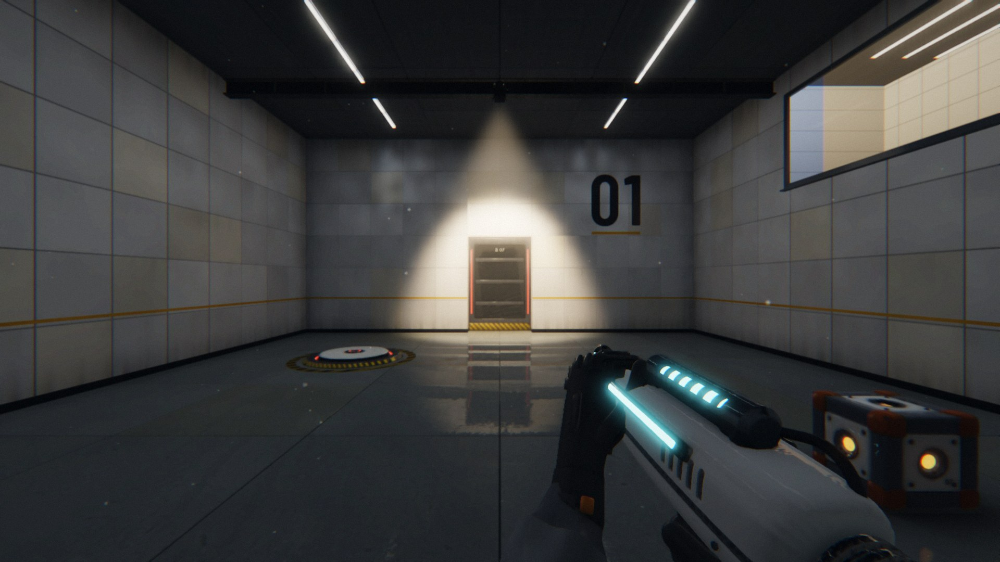

# Loophole Engine

A 3D game engine for Scratch and TurboWarp. You describe the world in a short Python file, run one command, and get an `.sb3` you open in TurboWarp and program with ordinary Scratch blocks.



The renderer bakes global illumination into lightmaps, shades surfaces with PBR materials, reflects the room with parallax-corrected probes and screen-space reflections, and finishes each frame with temporal anti-aliasing, volumetric haze, bloom and ACES tone mapping.

Work in progress. See [ROADMAP.md](ROADMAP.md).

## Quick start

```
pip install -e .
loophole new mygame
cd mygame
loophole build
```

Open `My Game.sb3` in [TurboWarp](https://turbowarp.org/), click the stage and play with WASD, mouse, space and E.

## License

MIT. Bundled textures come from CC0 sources; see [CREDITS.md](CREDITS.md).
