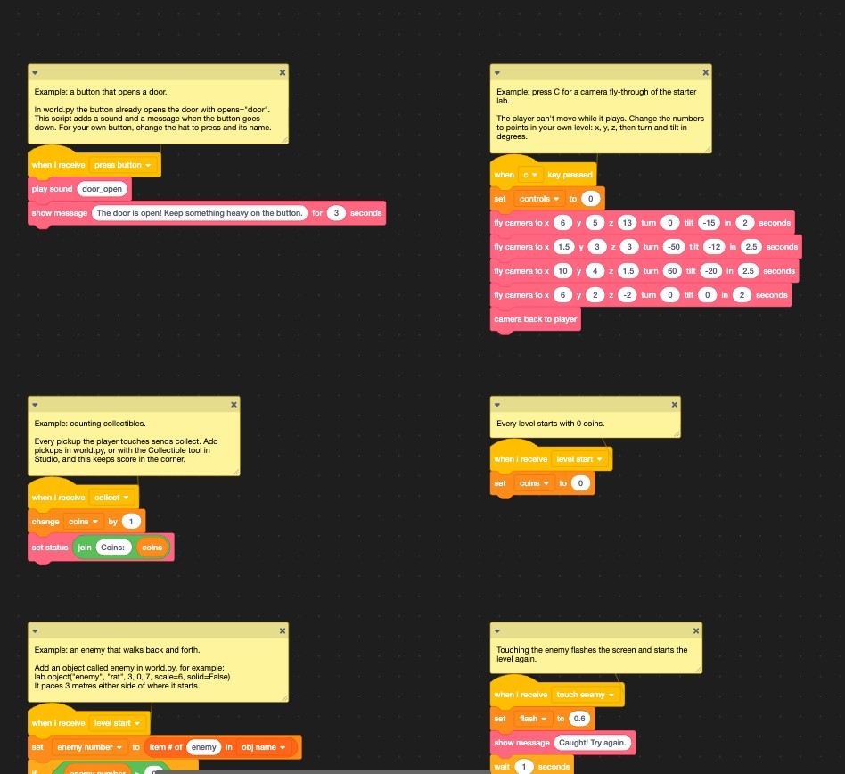

# Scratch API

A built game talks to your scripts through normal Scratch variables, lists and broadcasts on the Stage. You use them with the usual blocks: "set [variable] to", "change [variable] by", "item (1) of [list]", "replace item (1) of [list] with", "when I receive [message]" and so on.

Your own sprites, scripts and variables survive `loophole build`. The build replaces only the engine's own sprites (Engine, Engine Audio and Overlay) and, if you use `game.script`, the Game sprite.

## Helpers sprite

A new project comes with a sprite called Helpers. Its My Blocks section has ready-made blocks built from the variables and lists below:



| Block | What it does |
| --- | --- |
| `move object [name] to x () y () z ()` | Moves an object to a new spot. |
| `push [name] by x () y () z ()` | Shoves a physics object, adding to its speed. |
| `turn object [name] to () degrees` | Turns an object. |
| `show object [name]`, `hide object [name]` | Shows or hides an object. |
| `open [name]`, `close [name]` | Opens or closes a door or anything else that slides. |
| `play sound [name]` | Plays one of the sounds listed under `sound queue`. |
| `play sound [name] at x () y () z ()` | Plays a sound from a spot in the level, louder close by and from the left or right. |
| `rumble controller () for () seconds` | Shakes a connected game controller, strength 0 to 1. |
| `make [name] follow the player`, `make [name] wander`, `make [name] patrol its path`, `make [name] run away from the player`, `make [name] stop` | Changes what a character does. |
| `make [name] walk to x () z ()` | Sends a character to a spot. It finds its own way around walls. |
| `swing sword`, `throw` | The same as pressing F or G. Needs `game.combat()` in `world.py`; `throw` also needs a `projectile`. |
| `damage [name] by ()` | Takes health from an enemy. At 0 it is defeated. |
| `heal player by ()` | Gives the player health, up to `max health`. |
| `show message [text]`, `show message [text] for () seconds` | Big text near the bottom of the screen. |
| `set status [text]` | Small text in the top left corner. |
| `teleport player to x () y () z ()` | Moves the player. |
| `switch light [name] to ()` | 1 turns a named light on, 0 turns it off. |
| `start weather [kind]` | `clear`, `rain`, `snow` or `fog`. |
| `go to level ()` | Loads a level. |
| `fade to black in () seconds`, `fade in from black in () seconds` | Fades the screen. |
| `fly camera to x () y () z () turn () tilt () in () seconds` | Glides a free camera, for cutscenes. |
| `camera back to player` | Ends a fly camera. |
| `play cutscene [name] and wait`, `skip cutscene` | Plays a cutscene from `world.py` and waits for it to finish, or stops the one playing. |
| `save game to slot ()`, `load game from slot ()`, `delete save slot ()` | Saves the level, the player's position, the checkpoint, which objects are collected or open, and the `save data` list on this computer, in TurboWarp's local storage. Loading an empty slot sets `save found` to 0. |
| `make save code`, `load save code ()` | Turns the same save into `save code`, digits only, so it fits in a cloud variable or can be written down. Letters in `save data` come back in capitals. |

It also has four example scripts with notes beside them: a button that opens a door, counting collectibles, an enemy that walks back and forth, and a camera fly-through on the C key. Custom blocks belong to the sprite they are made in, so build your scripts in Helpers, or drag the definitions onto another sprite to copy them. Delete the sprite if you don't want it; a rebuild won't bring it back.

## Variables

Variables marked "read" are updated by the engine every frame. Variables marked "set" are yours to change, and the engine reads them every frame.

### Player

| Variable | Use | Meaning |
| --- | --- | --- |
| `player x`, `player y`, `player z` | read, set | Feet position in metres. Set all three to teleport. |
| `player yaw` | read, set | Facing in degrees. 0 looks toward -z, 90 toward +x. |
| `player pitch` | read, set | Looking up (positive) or down (negative), in degrees. |
| `player speed` | read | Horizontal speed in metres per second. |
| `player on ground` | read | 1 when standing on something, 0 in the air. |
| `water depth` | read | How deep the player's feet are under water, in metres. 0 on land. Over about 1.2 the player swims. |
| `walk speed` | set | Running speed. Default 6. |
| `jump power` | set | Jump speed. Default 7. |
| `gravity` | set | Default 20. |
| `controls` | set | 1 lets the player move and look. 0 freezes them, for cutscenes and endings. |

### Looking and holding

| Variable | Use | Meaning |
| --- | --- | --- |
| `looking at` | read | Number of the object under the crosshair (its position in the `obj name` list), or 0. |
| `looking distance` | read | Distance to that object. |
| `holding` | read, set | Number of the object being carried, or 0. Set it to 0 to drop it. |
| `used object` | read | Number of the last object the player pressed E on (objects made with `use=True`). |
| `last touched` | read | Name of the last object the player walked into. |
| `last collected` | read | Name of the last pickup collected. |
| `last trigger` | read | Name of the last trigger entered or left. |

### Camera

| Variable | Use | Meaning |
| --- | --- | --- |
| `camera mode` | set | 0 first person, 1 free camera, 2 third person, 3 top down. |
| `camera distance` | set | Distance behind or above the player in modes 2 and 3. |
| `camera yaw`, `camera pitch` | read, set | Orbit angles in modes 2 and 3. In mode 1 they aim the free camera. |
| `camera x`, `camera y`, `camera z` | read, set | Camera position. Set them in mode 1 to place a free camera. |
| `field of view` | set | Vertical field of view in degrees. |
| `viewmodel` | set | What the player holds in first person: `none`, `arms`, `device`, or any name listed in `Game(viewmodels=...)`. |

### Screen

| Variable | Use | Meaning |
| --- | --- | --- |
| `message` | set | Large text near the bottom of the screen. It fades in when it changes. Set it to empty to hide it. |
| `status` | set | Smaller text in the top left corner, for score, health or time. |
| `fade` | set | 0 is normal and 1 is black. Count it up in a loop for a fade-out. |
| `flash` | set | Set to about 0.5 for a white flash when the player is hurt. It fades back by itself. |
| `exposure` | set | Brightness multiplier. Default 1. |
| `weather` | read, set | `clear`, `rain`, `snow` or `fog`. The weather fades in over a few seconds: rain darkens and wets the ground and leaves puddles, snow falls and settles on the ground, and fog closes in. |
| `quality` | read, set | Render quality from 1 to 4. Quality 2 to 4 render 1280, 1600 and 1920 pixels wide. Quality 1 renders 960 wide, fades outdoor scenes into fog by 60 m, draws detail leaves only within 14 m and updates the depth buffer every other frame. The engine lowers it by itself, to 2 if the game stays under 50 frames per second and to 1 under 36, unless `Game(auto_quality=False)`. |

### Input

These combine the keyboard, a game controller and the touch controls, so one script works on every device.

| Variable | Use | Meaning |
| --- | --- | --- |
| `input x` | read | Sideways movement from -1 (left) to 1 (right). A controller stick or the touch joystick gives values in between. |
| `input y` | read | Forward movement from -1 (back) to 1 (forward). |
| `input jump` | read | 1 while jump is held. |
| `input use` | read | 1 while use is held. |
| `touch controls` | read, set | 1 while the on-screen joystick and buttons are showing. Set it to 1 or 0 to show or hide them. |
| `gamepad` | read | 1 while a game controller is connected. |
| `attack`, `throw` | set | Set to 1 to swing or throw once, as if the player pressed F or G. |

### Vehicles

| Variable | Use | Meaning |
| --- | --- | --- |
| `driving` | read | Name of the vehicle the player is in, or empty when walking. |
| `vehicle speed` | read | Speed in metres per second. |
| `engine rpm` | read | From 0 at idle to 1 at full speed. |

### Combat

These work after `game.combat()` in `world.py`.

| Variable | Use | Meaning |
| --- | --- | --- |
| `health` | read, set | The player's health. Enemy hits lower it, and at 0 the player respawns with `max health`. |
| `max health` | read, set | Health after a respawn. Starts at `game.combat(health=...)`. |

### Game flow

| Variable | Use | Meaning |
| --- | --- | --- |
| `level` | read | Current level number, starting at 1. |
| `level name` | read | Name given in `game.level("...")`. |
| `level time` | read | Seconds since the level started. |
| `go to level` | set | Set it to a level number to load that level. A negative number, like -2, loads level 2 without playing its opening cutscene. The engine sets it back to 0. |
| `paused` | read, set | 1 while paused. Set it to 1 to pause, 0 to resume. |
| `mouse locked` | read | 1 while the mouse is captured for looking around. |
| `fps` | read | Frames per second. |
| `cutscene` | read, set | Set it to a cutscene's name to play it. It goes back to empty when the cutscene ends. Set it to empty to stop one. |
| `checkpoint x`, `checkpoint y`, `checkpoint z`, `checkpoint yaw` | read, set | Where the player respawns. Empty means the level's start. Set them to make your own checkpoint. |

## Lists

Each object in the current level has one item in every `obj` list, in the order the objects appear in `world.py`. Find an object's number with "item # of [rat1] in [obj name]".

| List | Use | Meaning |
| --- | --- | --- |
| `obj name` | read | Object names. |
| `obj x`, `obj y`, `obj z` | read, set | Positions. |
| `obj yaw`, `obj pitch`, `obj roll` | read, set | Rotation in degrees. |
| `obj scale` | read, set | Size multiplier. |
| `obj visible` | read, set | 1 shown, 0 hidden. Hidden objects do not collide or send touch events. |
| `obj solid` | read, set | 1 blocks the player. |
| `obj glow` | read, set | Brightness of the object's glowing parts. |
| `obj open` | read, set | For doors and sliding objects, 1 opens and 0 closes. Buttons set it for you. |
| `obj touching` | read | 1 while the player touches the object. |
| `light name` | read | Names of the level's lights. Unnamed lights are called light1, light2 and so on. |
| `light power` | read, set | Brightness of each light. Named lights switch on with 1 and off with 0. |
| `trigger name` | read | Names of the level's triggers and goals. |
| `trigger inside` | read | 1 while the player is inside that trigger. |
| `obj mode` | read, set | What a moving character is doing: `follow`, `wander`, `patrol`, `flee`, `goto`, `stop`, or empty for objects that don't think. |
| `obj goal x`, `obj goal z` | read, set | Where a character in `goto` mode walks to. |
| `obj vx`, `obj vy`, `obj vz` | read, set | Speed of a physics object in metres per second. Set `obj vy` to 6 to throw it up. |
| `obj sees player` | read | 1 while that character can see the player. |
| `obj health` | read, set | Health of objects made with `health=`. Set it to 0 to defeat one. |
| `save data` | read, set | Anything you want kept in a save, like score or health. The save blocks store every item and put them back on load. |
| `sound queue` | add | Add a sound name and the engine plays it: `alarm`, `arrive`, `boost`, `button`, `click`, `door_close`, `door_open`, `fail`, `hum`, `impact`, `jump`, `land`, `pickup`, `release`, `rumble`, `success`, `unpress`, `whoosh`. |

Example: switch on a light called `beacon1` when the player collects something.

```
when I receive [collect]
replace item (item # of [beacon1] in [light name]) of [light power] with (1)
```

## Broadcasts

The engine sends these. Use them with "when I receive".

| Broadcast | When |
| --- | --- |
| `level start` | A level has loaded and faded in, including the first one. |
| `collect` and `collect <name>` | The player collected a pickup. `last collected` holds the name. |
| `touch` and `touch <name>` | The player started touching an object. `last touched` holds the name. |
| `enter` and `enter <name>` | The player walked into a trigger or goal. `last trigger` holds the name. |
| `leave` and `leave <name>` | The player walked out of a trigger. |
| `press <name>` | A button went down. |
| `release <name>` | A button came back up. |
| `use <name>` | The player pressed E while looking at an object made with `use=True`. |
| `player died` | The player hit a hazard and is respawning. |
| `paused`, `resumed` | The game paused or resumed. |
| `game complete` | The player reached the goal of the last level. |
| `portal` | The player placed a portal (only with `Game(portals=True)`). |
| `sees player` and `sees <name>` | A character with a `mode` spotted the player. |
| `lost <name>` | That character can no longer see the player. |
| `checkpoint` | The player walked through a new checkpoint. |
| `cutscene done` and `cutscene done <name>` | A cutscene finished or was skipped. |
| `hit <name>` | The player hit that enemy. |
| `defeated` and `defeated <name>` | An enemy's health reached 0. |
| `player hurt` | An enemy hit the player. `health` is already lower. |
| `enter vehicle`, `exit vehicle` | The player got into or out of a vehicle. |

Use the plain broadcast (`touch`) when you want one script for many objects and check `last touched`. Use the named one (`touch rat1`) when only one object matters.

Example: lose health when any rat touches the player.

```
when I receive [touch]
if <(last touched) contains [rat]> then
  change [health] by (-1)
  set [flash] to (0.6)
end
```

## Controls

| Input | Action |
| --- | --- |
| Click the stage | Capture the mouse and start playing. |
| W A S D | Move. In third person and top down, movement is relative to the camera. |
| Mouse or arrow keys | Look around, or orbit the camera. |
| Space | Jump. |
| Shift or C | Crouch. |
| E | Pick up, drop or use the object under the crosshair. |
| R | Restart from the spawn point. |
| Left and right click | Place the blue and orange portals, when portals are on. |
| P or Escape | Pause. |

## Python gameplay scripts

`game.script("game.py")` compiles a Python file into Scratch blocks inside a sprite called Game. You can open that sprite in TurboWarp and read or change the blocks it made. Engine variables use underscores in place of spaces: `player_x`, `camera_mode`, `last_touched`, `light_power`, `obj_open`, `go_to_level`.

```python
@when_broadcast("level start")
def begin():
    score = 0
    status = "Score 0"


@when_broadcast("collect")
def got():
    score += 1
    status = join("Score ", score)
    if score == 10:
        message = "You win!"
        controls = 0
```

Supported:

- Hats: `@when_flag`, `@when_broadcast("name")`, `@when_clone`. Plain functions become custom blocks.
- Control flow: `if`, `elif`, `else`, `while`, and `for i in range(n)` or `range(a, b)`.
- Waiting and messages: `wait(seconds)`, `broadcast("name")`, `broadcast_wait("name")`.
- Lists: `my_list[i]` (indexes start at 1, as in Scratch), `.append()`, `.insert()`, `.pop()`, `.clear()`, `len(list)`, `item in list`, `index_of(list, item)`.
- Text: `join(a, b)`, `letter(i, text)`, `strlen(text)`, `"rat" in text`.
- Maths: `+ - * / %`, comparisons, `and`, `or`, `not`, `abs`, `sqrt`, `sin`, `cos`, `floor`, `round`, `min`, `max`, `random(a, b)`.
- Input: `key("space")`, `mouse_x()`, `mouse_y()`, `mouse_down()`, `timer()`.
- Sound: `sound_queue.append("pickup")` plays one of the engine's sounds.

New variable names become variables on the Game sprite, and names from `game.variable` are shared on the Stage.
