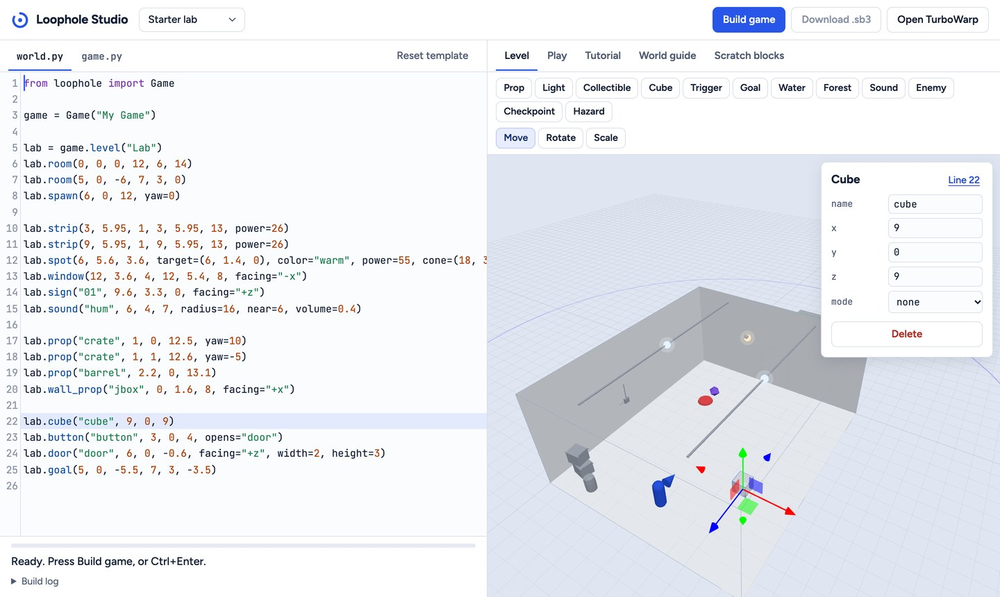
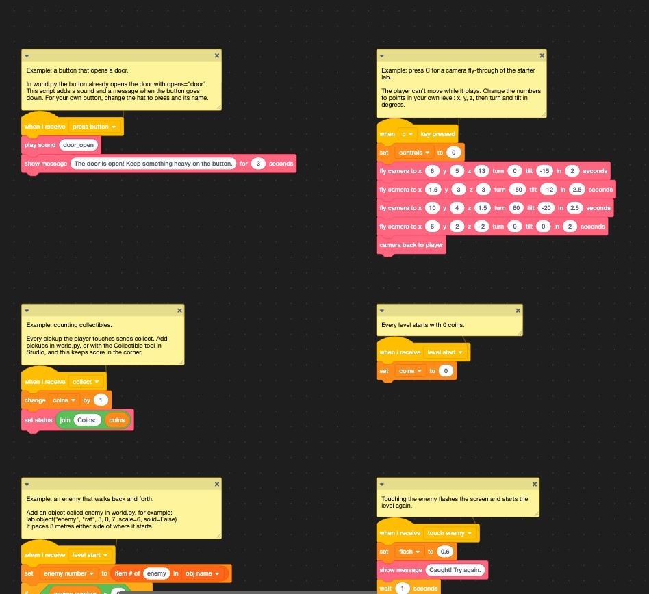

# Your first game

This walks you through making a small game in [Loophole Studio](https://q8j-dev.github.io/loophole-engine/): collect three apples while a rat chases you, then win. It takes about 15 minutes and you don't need to install anything.



## 1. Open the starter lab

Open Studio and pick **Starter lab** from the menu at the top. The left side is `world.py`, the file that describes your level. The right side shows the same level in 3D.

Drag in the 3D view to look around, right-drag to slide, and scroll to zoom. Click anything to select it: its line in `world.py` lights up and its settings appear in the panel.

## 2. Play it

Press **Build game**. The first build takes about half a minute while Studio downloads what it needs, and later builds are quicker. The game plays in the **Play** tab.

Click the game to start. Move with WASD, look with the mouse, jump with space and pick up the cube with E.

## 3. Add three apples

Go back to the **Level** tab and press **Collectible**, then click the floor. An apple appears, and a new line appears at the bottom of `world.py`:

```python
lab.pickup("apple1", "apple", 4, 0.4, 10, scale=3)
```

Add two more in different places. To move one, select it and drag the arrows. To get rid of one, select it and press **Delete**.

## 4. Add a rat that chases you

Press **Enemy** and click the floor at the far end of the room. The orange ring shows how far the rat can see. When you walk into that ring and the rat can see you, it starts following you.

Select the rat to see its settings. **mode** says what it does: `follow` chases you, `wander` strolls around, `flee` runs away and `stop` stands still. **speed** is how fast it moves.

## 5. Add a checkpoint

Press **Checkpoint** and click near the middle of the room. When you walk through it, you come back to life there instead of at the start.

## 6. Build and play again

Press **Build game** and try your level. If something is in the wrong place, fix it in the 3D view or in `world.py` and build again.

## 7. Make it a real game in TurboWarp

Press **Download .sb3**, open [turbowarp.org/editor](https://turbowarp.org/editor) and choose **File > Load from your computer**.

Click the **Helpers** sprite. It already has ready-made blocks and example scripts, each with a note above it. The coin example counts every apple you collect. Drag an **if** block onto the end of that script so that the third apple wins the game:

```
when I receive [collect]
change [coins] by (1)
set status (join [Coins: ] (coins))
if <(coins) = (3)> then
  show message [You win!]
  play sound [success]
```

The rat example in the Helpers sprite needs an object called `enemy`, but yours is called `rat1`, so add a script for when it catches you:

```
when I receive [touch rat1]
show message [Caught! Try again.] for (2) seconds
go to level (1)
```



## 8. Share it

Choose **File > Save to your computer** to keep your game. To share it with friends, choose **File > Package project** in TurboWarp. It turns your game into a single web page or an app that anyone can open.

## What next

- More things to put in a level: [World guide](world-api.md).
- Every variable, list and block your scripts can use: [Scratch guide](scratch-api.md).
- Want a forest, a lake or snow? Pick **The Long Walk** in Studio to see how it's made.
